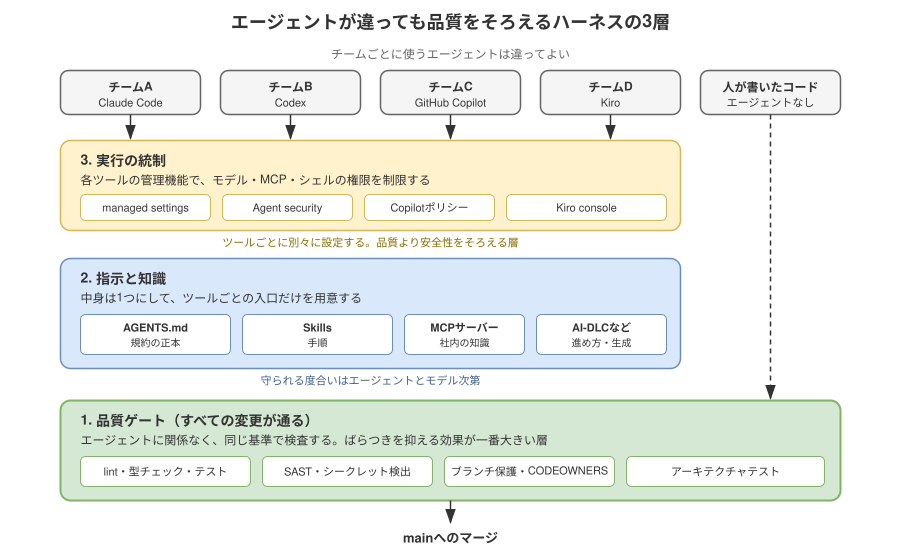

## はじめに

以前の記事「[AI駆動開発で「誰でもアプリが作れる時代」に、なぜエンジニアのハーネスが必要なのか](https://qiita.com/umemasa3/items/ebf788505c3e926155f0)」では、AIが書いたコードを組織で安全に運用するためのハーネスの考え方を紹介しました。
今回はその続きで、エンジニア向けに具体的な作り方と管理の仕方を書きます。

大規模なプロジェクトでは、チームごとや人ごとに使うコーディングエージェントが違うのが普通になりつつあります。
あるチームはClaude Code、別のチームはCodex、また別のチームはGitHub CopilotやKiro、という具合です。
ライセンスの事情、得意なタスクの違い、個人の好みなど理由はさまざまで、1つに統一するのは現実的でないことが多いと思います。

この記事では、使うエージェントがばらばらでも成果物の品質をそろえるために、ハーネスをどう作り、どう管理するかを整理します。
ツールの仕様は2026年11月時点の公式ドキュメントとリポジトリをもとにしています。

## エージェントが違うと何がばらつくか

同じ依頼をしても、エージェントやモデルが違えば成果物は変わります。
よく差が出るのは、次のような部分です。

- コードの書き方の癖（関数の分け方、エラー処理の書き方、コメントの量）
- テストの書き方と量（テストを書くか、どこまで書くか）
- 規約がどこまで守られるか
- 変更の範囲（頼んだ部分だけ直すか、周りまで書き換えるか）

規約については、指示ファイルに書けば解決すると考えがちです。
しかし、指示ファイルに書いた内容がどこまで守られるかは、エージェントとモデルによって違います。
Claude Codeの公式ドキュメントも、CLAUDE.mdは文脈として読むもので、強制される設定ではないと明記しています。

## 品質はエージェントの外側でそろえる

この記事の中心になる考え方は、品質をそろえる仕組みをエージェントの外側に置くことです。
最終的な品質は、AIが書いたか人が書いたか、どのエージェントで書いたかに関係なく、すべての変更が通るゲートで担保します。

指示ファイルの共通化は、そのゲートに一度で通りやすくするための手段と位置づけます。
指示を守らないエージェントがあっても、ゲートで止まれば品質は下がりません。
逆に、ゲートがないまま指示ファイルだけ整えても、守られる度合いの差がそのまま品質の差になります。

## ハーネスの3層

ハーネスは、次の3つの層に分けて作ります。

| 層 | 役割 | ツールへの依存 | 強制力 |
|----|------|--------------|-------|
| 品質ゲート | すべての変更を同じ基準で検査する | なし | 強制する |
| 指示と知識 | 規約、手順、社内の知識を渡す | 中身は共通、入口はツールごと | 守られる度合いはツール次第 |
| 実行の統制 | モデル、MCP、シェルの権限などを制限する | ツールごとに設定する | クライアント側で強制する |

### 1. 品質ゲート

エージェントに関係なく、すべての変更が同じ基準を通るようにする層です。
ばらつきを抑える効果は、この層が一番大きいです。

- CIで、フォーマット、lint、型チェック、テスト、カバレッジの下限を検査する
- CIで、SASTとシークレットの検出、依存パッケージの脆弱性検査を行う
- ブランチ保護、CODEOWNERS、PRテンプレートで、人のレビューを必須にする
- pre-commit hookで、手元でも同じ検査を走らせる

「設計規約」「命名規則」のように言葉で書きがちなルールも、できるだけlintルールやアーキテクチャテスト（依存方向の検査など）にして、この層に入れます。
言葉で書いたルールは守られる度合いがばらつきますが、検査にしたルールは必ず同じ結果になります。

### 2. 指示と知識

エージェントに渡す規約や手順を、1か所で管理する層です。
中身は1つにして、ツールごとの入口だけを用意します。

- 正本はAGENTS.mdにする。Claude Code（v2.1.277以降）、Codex、Kiroなど、多くのツールが直接読む
- ツールごとの事情に注意する。たとえばClaude Codeは、CLAUDE.mdがあるとAGENTS.mdを読まない。その場合はCLAUDE.mdから`@AGENTS.md`で読み込ませる
- 手順はSkillsの形式（SKILL.md）で書く。「APIを追加する手順」「マイグレーションの書き方」などを、複数のツールで使い回せる
- 社内の知識はMCPサーバーで共有する。設計ドキュメントや社内APIの仕様を返すサーバーを1つ用意して、各ツールからつなぐ
- 変換が必要なツール向けのファイルはスクリプトで生成し、正本とずれていないかをCIで検査する

各ツールが読むファイルの形式や対応状況は、頻繁に変わります。
ツール固有の機能に頼りすぎず、どのツールでも使える範囲で書くのが安全です。

### 3. 実行の統制

使えるモデル、MCPサーバー、シェルの権限などを、各ツールの管理機能で制限する層です。
この層はツールごとに別々に設定することになり、品質というより安全性をそろえるための層です。
各ツールの管理機能の違いは、[AIコーディングエージェント5製品のガバナンス比較の記事](https://qiita.com/umemasa3/items/c4a80de8601c6062ff75)で整理しました。

## 指示と知識の層を実装する道具

2番目の層を自分で一から作る代わりに、既存の道具を使う手もあります。
道具は、担っている役割で大きく2つに分かれます。

- 開発の進め方をそろえる道具。要件、設計、実装といった段階と、人の承認ゲートを決める
- 1つの中身から各ツール向けのファイルを生成する道具。規約や手順を1か所に書き、ツールごとの形式に変換する

### AWSのAI-DLC

[AI-DLC（AI-Driven Development Life Cycle）](https://github.com/awslabs/aidlc-workflows)は、AWSが公開している開発の進め方の枠組みです。
2つの役割の両方を持っている点が特徴で、大規模なプロジェクトで進め方まで統一したい場合の候補になります。

- 初期化、アイデア出し、要件と設計、実装、運用の5つのフェーズに分かれ、ほとんどの段階に人の承認ゲートがある
- 次にどの段階を実行するかは、LLMではなくコードが決める。同じ状態からは、どのエージェントでも同じ次の段階に進む
- ツールに依存しない`core/`から、Claude Code、Kiro（IDE / CLI）、Codex CLI、Cursor、opencode、GitHub Copilot向けのファイルを生成する
- フレームワークが持つ方法論と、チームが書き足す知識の置き場所が分かれている。人の指摘をルールとして残す仕組みもある
- 作業の記録と状態ファイルが残り、どの判断を誰が承認したかを後から追える

導入するときは、作業の重さに合わせたプロファイルを使い分けます。
全部で30以上の段階があるため、小さな修正にはbugfixのような軽いプロファイルを使わないと手間が増えます。
更新も頻繁で、2.11.3以前と最新版ではKiro用の指定名の意味が入れ替わっているので、チームでそろえるならバージョンを固定します。

### そのほかの道具

AI-DLCのほかにも、同じ役割を担う道具があります。
ここでは公式のリポジトリで内容を確認できたものを挙げます。

| 名前 | 役割 | 特徴 |
|------|------|------|
| [BMAD Method](https://github.com/bmad-code-org/BMAD-METHOD) | 進め方をそろえる | 製品、設計、開発、テストなどの視点を持つエージェントで進める。作業の大きさに合わせて計画の深さを変えられる |
| [cc-sdd](https://github.com/gotalab/cc-sdd) | 進め方をそろえる | Kiroに近い仕様駆動の進め方をAgent Skillsとして配る。Claude CodeとCodexが安定版、Antigravityなど6つがベータ |
| [GitHub Spec Kit](https://github.com/github/spec-kit) | 進め方をそろえる | 仕様、計画、タスク、実装の順に進める。組織の標準を強制するプリセットや、社内専用のカタログを持てる |
| [OpenSpec](https://github.com/Fission-AI/OpenSpec) | 進め方をそろえる | 軽量で、段階の縛りがゆるい。仕様を別リポジトリに置いて複数のリポジトリから参照する機能がある（ベータ） |
| [Ruler](https://github.com/intellectronica/ruler) | ルールを配る | `.ruler/`に書いたルールとMCPの設定を、各エージェントの設定ファイルに配る |
| [rulesync](https://github.com/dyoshikawa/rulesync) | ルールを配る | ルール、MCP、コマンド、サブエージェント、Skillsなどを、多数のツール向けに生成する |

選び方の目安は次のとおりです。

- 進め方まで統一したい大規模なプロジェクトには、AI-DLCかBMAD Method
- 仕様を書いてから実装する流れだけを入れたいなら、Spec Kit、OpenSpec、cc-sdd
- 進め方はチームに任せ、規約と手順を配るだけでよいなら、Rulerかrulesync

ルールが少ないうちは、道具を入れずにAGENTS.mdを正本にし、ほかのファイルから参照させるだけでも足ります。
どの道具も、対応しているエージェントの一覧は頻繁に変わるので、導入前に最新の対応表を確認してください。

### 品質ゲートの代わりにはならない

これらの道具は、どれも品質ゲートの代わりにはなりません。
AI-DLCを例にすると、lintや型チェックを実行する「sensors」という仕組みがありますが、結果を記録に残すだけで作業は止めません。
作業を止める仕組みは、作業の終了時に動くhookの1つだけです。

また、hookは各ツールのクライアント側で動きます。
道具を使わない人や設定を外した人がいれば、その検査は通りません。
最終的な品質は、これまでどおりCIとブランチ保護で担保します。

組み合わせるときは、道具の中で動かすlintとCIのlintに同じ設定ファイルを使わせます。
こうすると、手元では通ったのにCIで落ちる、というずれを防げます。

## ハーネスの管理の仕方

### 置き場所と責任者

ハーネスは独立したリポジトリにして、プラットフォームチームが責任者になります。
各チームは、変更したいことがあればPRで提案します。
ハーネスの変更も、コードと同じようにレビューを通してから反映します。

### 上書きできる範囲を決める

設定は、全社共通、チーム、リポジトリの順に上書きできる構成にします。
ただし、何でも上書きできるようにすると、ハーネスを用意した意味がなくなります。

| 層 | チームやリポジトリで上書きしてよいもの | 上書きさせないもの |
|----|------------------------------------|-----------------|
| 品質ゲート | 検査を追加すること、基準を厳しくすること | 検査を外すこと、カバレッジなどの基準を下げること |
| 指示と知識 | チーム固有の規約、Skillsの追加 | セキュリティに関する規約 |
| 実行の統制 | 許可された範囲で、使うエージェントやMCPサーバーを選ぶこと | 許可されていないモデルやMCPサーバーを使うこと |

### バージョンを付けて配布する

ハーネスにはバージョンを付けて配布します。
各リポジトリへの反映は、テンプレートと、同期のPRを自動で出すbotで行います。
こうすると、どのリポジトリがどのバージョンを使っているか、反映が漏れていないかを追えます。

## 効果が出ているかを確かめる

ハーネスを入れたら、品質がそろってきているかを定期的に確かめます。
確かめ方は、評価用のタスクで比べる方法と、本番のPRの記録から見る方法の2つです。

1つ目は、代表的なタスク（小さな機能追加、バグ修正、リファクタリングなど）を10〜20個用意し、各エージェントで定期的に実行する方法です。
品質ゲートを1回で通った割合や、人のレビューでの指摘の数を比べます。
モデルやツールが更新されたとき、ハーネスを変えたときにも、この評価を回し直します。

2つ目は、本番のPRにどのエージェントで作ったかを記録しておく方法です。
コミットのトレーラー（`Co-authored-by`など）に記録しておけば、エージェント別にCIの失敗率やレビューでの差し戻し率を集計できます。
特定のエージェントだけ数字が悪ければ、そのエージェント向けの入口の設定を見直します。

## ハーネスの育て方

レビューで同じ指摘が繰り返し出たら、まずlintルールやテストにできないかを考えます。
検査にできれば、どのエージェントにも同じ結果で適用できるからです。
検査にできないものだけを、AGENTS.mdやSkillsに書き足します。

指示ファイルは厚くしすぎないようにします。
Claude Codeの公式ドキュメントも、CLAUDE.mdは1ファイル200行以内を目安にし、長くなるほど守られにくくなるとしています。
ほかのツールでも同じ傾向があり、長くなるほどツールによる差も広がります。

:::note warn
特定のツールにしかない機能（専用のhooksなど）に品質を頼ると、そのツールを使っていないチームで品質がばらつきます。
品質に関わる仕組みは、どのツールでも同じように動く層（CIなど）に置いてください。
:::

## まとめ

- エージェントが違えば、書き方の癖、テストの量、規約の守られ方が変わる
- 品質をそろえる仕組みはエージェントの外側に置く。最終的な品質は、すべての変更が通る品質ゲートで担保する
- ハーネスは3層で作る。品質ゲート（CI、ブランチ保護）、指示と知識（AGENTS.md、Skills、MCP）、実行の統制（各ツールの管理機能）
- 指示と知識の層は、AI-DLCなどの道具でも実装できる。ただし、どの道具も品質ゲートの代わりにはならない
- ハーネスは独立したリポジトリでプラットフォームチームが管理し、上書きできる範囲を決め、バージョンを付けて配布する
- 効果が出ているかは、評価用のタスクとエージェント別のCIの記録で確かめる

エージェントを1つに統一できないことは、悪いことばかりではありません。
チームごとに合ったツールを選べる自由を残しながら、品質の下限だけを全社でそろえる、というのが現実的な落としどころだと考えています。
